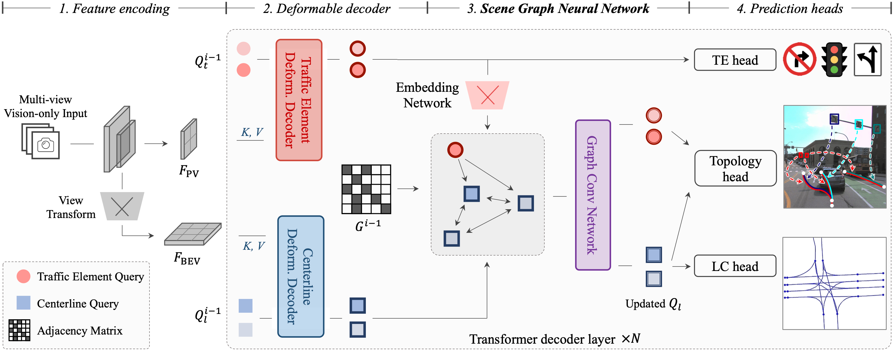
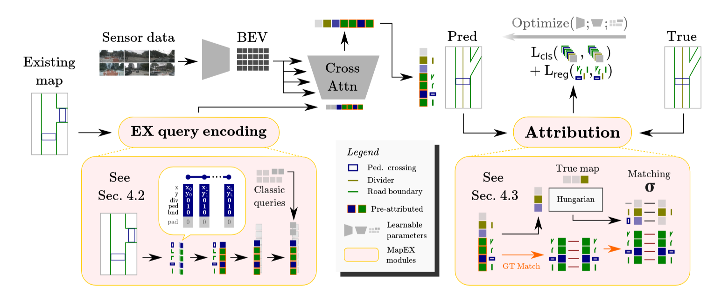
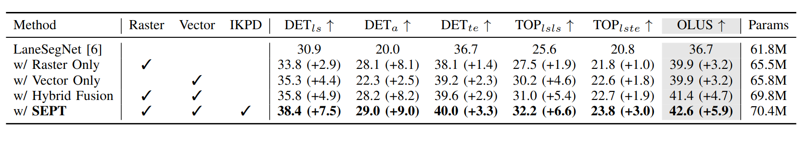
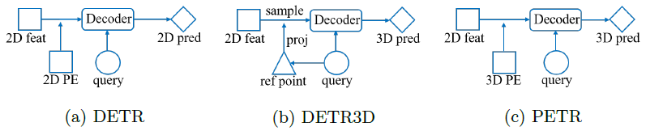

# 在线高精算法论文阅读笔记

\[TOC]

## 1. 基础论文

### HDMapNet: An Online HD Map Construction and Evaluation Framework

1.  参考文档：

    *   论文：<https://www.cnblogs.com/xiaoliu-ya/p/16553462.html>

    *   代码：<https://github.com/Tsinghua-MARS-Lab/HDMapNet/tree/main>

2.  参考笔记的补充：

    *   关于语义预测：很普通的FCN加上交叉损失熵函数；

    *   关于实例预测：

        *   损失函数详见Lanenet。有点疑惑这种依赖参数的表示方式会不会鲁棒性比较差？

        *   $C(C-1)$ 是组合数公式去掉了系数；

    *   关于方向预测：

        *   理解为转换为一个二分类问题，这里其实可以参考环形标签（旋转目标检测）论文来改进方向；
        *   地图上的大多数像素都不位于车道上，这意味着它们没有方向。 这些像素的方向向量是零向量。作者不在训练期间对这些像素进行反向传播。

    *   关于向量化： 在推断过程中，首先使用基于密度的带噪声应用空间聚类 (DBSCAN) 对实例嵌入进行聚类。然后使用非极大值抑制来减少冗余。最后，利用预测的方向贪婪地连接像素，得到向量表示。

3.  代码原理补充：

    *   关于批量标准化图像：正向标准化的方程为：$z = (x - \text{mean}) / \sigma$，因此有：

        $$
        \begin{aligned}
        x &= z * \sigma + \text{mean} \\
          &= (z + \text{mean}/\sigma) * \sigma \\
          &= \left(z - \left(-\text{mean}/\sigma\right)\right) / (1/\sigma) \\
          &= (z - \text{mean}^{-1} )/ \sigma^{-1} \\
         \end{aligned}
        $$

        这解释了代码：

        ```
        class NormalizeInverse(torchvision.transforms.Normalize):
            #  https://discuss.pytorch.org/t/simple-way-to-inverse-transform-normalization/4821/8
            def __init__(self, mean, std):
                mean = torch.as_tensor(mean)
                std = torch.as_tensor(std)
                std_inv = 1 / (std + 1e-7)
                mean_inv = -mean * std_inv
                # super()：通常在子类中使用，用于在子类中调用父类的方法或属性
                super().__init__(mean=mean_inv, std=std_inv)

            # __call__：可以使得方法变成可被调用对象
            def __call__(self, tensor):
                return super().__call__(tensor.clone())
        ```

    *   更多内容详见代码笔记文件夹

### VectorMapNet: End-to-end Vectorized HD Map Learning

1.  论文核心点：

    *   与HDMapNet相比，采用了端到端而非HDMapNet中的几何后处理方案，直接输出矢量化而非栅格地图；
    *   使用DETR来检测出关键点，再直接利用生成器矢量化为polyline，以适应地图元素的异构性；

2.  补充信息：

    *   Ramer-Douglas-Peucker (RDP) 算法：将曲线用尽量少的点采样成折线的算法

    *   Teacher forcing：在训练时，将真实的目标序列作为解码器的输入，而不是将解码器自身生成的序列作为下一时刻的输入；这样可以使模型更容易学习到正确的序列生成方式，但是 open-loop 模式下，模型在训练时和测试的输入会有较大差异，因此通常会在训练过程中随机地使用Teacher Forcing或自回归的方式来训练模型

    *   Fréchet 距离：用于度量两个路径之间相似性的概念。对于两个离散点集 $P=\{p_1,p_2,...,p_N\}$ 和 $Q=\{q_1,q_2,...,q_M\}$ ，Fréchet距离定义为：


    $$
    \begin{aligned}
    D(i,j) &= ||p_i - q_j||\\
    L(i,j)&=\max\left(D(i,j), \min\left( L(i−1,j), L(i,j−1), L(i−1,j−1) \right) \right) \\
     F(P,Q)&=L(n,m)
     \end{aligned}
    $$

    直观理解Fréchet distance就是：主人走路径A，狗走路径B，各自走完这两条路径过程中所需要的最短狗绳长度。[参考链接](https://blog.csdn.net/qq_40206371/article/details/130039377)

    *   Chamfer 距离：用于度量两个点云之间相似性的距离度量。给定两个点云，Chamfer 距离衡量了将一个点云变形到另一个点云所需的最小平均平方距离：

        $$
        \text{Chamfer}(X,Y)=\frac{1}{m}\sum_{i=1}^{m} \min_{j} \| x_i - y_j \|^{2}+\frac{1}{n}\sum_{j=1}^{n} \min_{i} \| y_j - x_i \|^{2}
        $$

    *   多种IoU损失函数总结：<https://zhuanlan.zhihu.com/p/388622389>

3.  一些没有太理解的点：

    *   注意到元素关键点不同于多段线顶点，元素关键点是VectorMapNet的中间表示，每一类polyline生成的关键点数目恒定；
    *   为什么VectorMapNet 比HDMapNet 性能提高这么多？什么是问题的核心？

4.  实验结果中的比较关键的点：

    *   模型细节：

        *   在不知道地平面精确高度的情况下，这种单应性并不是精确的变换。为了缓解这个问题，在实际中我们将图像特征转化为4个不同高度的BEV平面( 我们用 - 1m , 0m , 1m , 2m )

    *   结论：

        *   向量化的优势：VectorMapNet可以保留尖锐的角点，而 polyline 表示避免了 VectorMapNet 生成模糊的自环绕结果（因为它一致地编码方向信息。相比之下，栅格的方法容易产生虚假循环曲线）。
        *   文中性能提高的原因分析：归因于模型对地图要素之间拓扑关系的建模能力，从而隐式地捕捉复杂的场景相互关系。
        *   当自车摄像头被附近车辆遮挡时，VectorMapNet ( Camera )无法感知周围地图。利用LiDAR的深度信息，Vector Map Net ( Fusion )可以得到比相机更可信的结果。
        *   polyline采样：第一种，在曲率变化超过一定阈值的位置对顶点进行采样。第二种，是以固定间隔( 1m )对顶点进行采样。结果基于曲率的采样方法大大优于固定采样方法。这是因为固定采样方法涉及大量的冗余顶点集合，这些顶点对几何结构的贡献可以忽略不计，因此在学习过程中低估了基本顶点（例如,折线拐角处的顶点）。

    *   扩展：

        *   使用VectorMapNet来预测中心线：将中心线视为多条线的集合，并隐式地编码它们的拓扑关系。

        *   扩展思考：[为什么要设计两层query呢？](https://www.sohu.com/a/689845043_560178)

5.  文章的缺陷：

    *   缺乏时间信息：模型在单帧中生成一致的几何图形，但不能保证预测的时间一致性；
    *   两阶段模型的失配问题：由于教师强制训练策略，地图元素检测器和折线生成器之间存在特征空间失配。虽然微调对于优化性能是必要的，但它会导致棘手的训练计划；
    *   幻觉能力：模型可以在被遮挡且摄像头不可见的位置进行预测，显示其场景理解能力。然而，这降低了模型的可解释性。
    *   地图要素的点虽然是有序的,但起点不是唯一的：MapTR解决的问题。
    *   较难推理和部署：利用自回归解码器顺序预测点，导致较长的推理时间（生成过程是序列性的,只能做到多个instance的并行,instance内部无法并行,降低了效率）。同时，直接推理到矢量化需要大量数据，很难收敛；

### MapTR: Structured Modeling and Learning for Online Vectorized HD Map Construction

1.  参考文档：

    *   <https://zhuanlan.zhihu.com/p/671394052>

2.  论文核心点：

    *   点集建模：采用`permutation-equivalent`（排列等价）方法：

        *   点集主要分成了两种，包括Polygon和Polyline。Polygon主要就是包含起点和终点的一个顺序，Polygon要复杂点，包括了顺时针和逆时针的各种组合的闭环。
        *   MapTR将预测闭环的索引映射到不同的排列中，从而形成一组等效的多边形表示；
        *   这种排列的目的是使得模型在处理排列敏感的多边形数据时能够不受排列顺序的影响，从而减少学习过程中的歧义，使得模型能够更容易、更稳定地学习到正确的多边形表达。统一地对地图元素进行建模，解决了模糊性问题。

    *   网络的真值**匹配**（即训练阶段匈牙利匹配）：和query的设计相同，也采用分层匹配方法，将地图元素集合视为固定大小，依次进行实例级匹配和Point-level匹配。

        *   实例级别的配对采用匈牙利最优匹配，通过类别约束（采用Focal Loss）和位置约束来筛选的；
        *   完成实例匹配后，每个实例中Point-level的配对是通过：预测点与真值等效点集的Manhattan距离约束来筛选的。

    *   网络的训练**损失**：

        *   分类损失：根据实例级的最佳匹配结果，采用Focal Loss预测类别标签；

        *   点对点的损失：根据点级最优匹配结果，采用Manhattan Loss预测每个点的位置；后续实验表明，point2point配对优于Chamfer距离代价；

        *   边缘方向损失：点对点损失只限制了折线和多边形的节点点，没有考虑边缘（相邻点之间的连接线），因此采用成对的预测边缘$ (\hat{e}_{\hat{\pi}(i),j})$和 GT 边缘$ (e_{i,\hat{\gamma}_i(j)})$的余弦相似度以限制较高边缘层次的几何形状：

            $$
            \mathcal{L}_{dir} = -\sum ^{N −1} _{i=0} \mathbb{1}_{\lbrace c_i \neq \varnothing \rbrace} \sum ^{N_v −1} _{j=0} \rm{cosine\_similarity}(\hat{e}_{\hat{\pi}(i),j},e_{i,\hat{\gamma}_i(j)}) \\

            \hat{e}_{\hat{\pi}(i),j} = \hat{v}_{\hat{π}(i),j} − \hat{v}_{\hat{π}(i),(j+1)\mod N_v} , \tag9  \\

            e_{i,\hat{\gamma}_i(j)} = v_i,\hat{\gamma}_{i(j)} − v_{i,\hat{\gamma}_i(j+1)\mod N_v} .
            $$

    *   是一种端到端的实时矢量化方案；

    *   MapTR还测试了对外参波动的容许度：

        *   角度偏差：0.02rad；平移偏差：0.1m；
        *   但是过大的偏差对性能影响会比较大；

3.  补充细节：

    *   Focal Loss：通过在标准交叉熵损失的基础上新增一个系数因子，从而减弱对容易样本的学习和加强对困难样本的学习，提高模型的分类能力。[参考链接](https://zhuanlan.zhihu.com/p/639004674?utm_id=0)

    *   Cosine Similarity：余弦相似性工具，主要判断角度变化；[参考链接](https://zhuanlan.zhihu.com/p/628061833)

    *   Deformable Attention：[参考链接](https://blog.csdn.net/qq_23981335/article/details/129123581)

4.  一些没有理解的点：

    *   MapTR对真值数据进行均匀采样（20个点，实验达到最好的性能，进一步增加点数会增加优化难度，导致性能下降），而非VectorMapNet 推崇的在曲率变化超过一定阈值的位置对顶点进行采样。不清楚为什么采用这个方案；

## 2. MapTR框架的改进

### MapTRv2: An End-to-End Framework for Online Vectorized HD Map Construction

1.  论文核心点：

    *   为了加快收敛速度，在训练时增加了一对多的辅助匹配分支，以增加正向样本数量：

        *   将真值的地图元素复制k份，地图元素数量增加至 T，因此一个真值地图元素可以匹配k个预测的地图元素。在训练时增加了正样本数量，使得decoder收敛更快。

    *   在透视视图和鸟瞰视图上引入辅助前景分割，并利用深度监督来引导骨干学习三维几何信息；

        *   为了显式地利用深度信息，BEV转换模块由GTK变为了LSS-based BEVPoolv2；
        *   QUS：车道线或者道路标识线加入深度监督真的有意义吗？收益比如何呢？

    *   引入了为分层查询机制量身定制的解耦自注意力，极大地减少了内存消耗并带来了增益；

        *   MapTR采用的自注意力机制使层次查询之间进行信息交换(既有实例间的,也有实例内的)，计算复杂度较大：点的数量是固定的，但随着实例数的增加，其消耗的内存资源也是逐步增加的；
        *   MapTRv2中解耦self-attention，即分别在inter-ins（实例内）和intra-ins（实例外）进行attention操作：后续实验表示，实例自注意力在很大程度上减少了训练内存，同时以可忽略的精度损失为代价。增加实例内的交互后少量增加训练内存，少量增加精度；

    *   提出三种cross-attention方式，分别是基于bev的 cross-attention、基于pv的cross-attention和两者结合的cross-attention：

        *   基于bev的 cross-attention 和 maptr 中的一样，消融实验表明在nus. 2D数据集中表现最佳，帧率相较于pv方法下降不多；
        *   基于pv的 cross-attention，得到预测的参考点集后，在投影到前视图上采集各点周围的特征值；
        *   两者结合的 cross-attention，就是将结合上述两种方式的attention方法，消融实验表明av2. 3D数据中表现最佳，但是帧率有明显的下降。

2.  相关文献：

    *   PolyDiffuse：在MapTR中引入扩散机制，通过条件生成过程进一步精化结果；
    *   MapVR：将可微的栅格化应用于MapTR产生的矢量化结果，以纳入精确和几何感知的监督；

3.  补充细节：

    *   自注意力机制的图示：[参考链接](https://blog.csdn.net/qq_41129489/article/details/127362272)

4.  疑惑：

    *   似乎对外参的容忍度从v1的0.02rad下降到了0.01rad（0.5°）

### PivotNet: Vectorized Pivot Learning for End-to-end HD Map Construction

1.  论文核心点：

    *   在集合预测框架中采用基于支点/枢纽点（Pivot-Based）表示对地图元素进行精确建模：

        *   MapTR固定每种元素的方法导致信息丢失，特别是对于圆角和直角，平滑性也较差；而VectorMapNet采用的由粗到细及自回归方法，会导致较长的推理时间和累积误差；
        *   将矢量化后的点集 S 按对地图要素形状的贡献分为：枢纽点序列Sp，和共线点序列Sc。枢轴序列由一组有序的枢轴点组成，这些枢轴点对整体形状有贡献，并且通常表示地图元素中方向的变化（具体挑选方式没有看懂）；

    *   点线掩码模块（point-to-line mask module）：

        *   输入：首先BEV特征输出经过`Line-aware Point Decoder`，得到点的描述子 $\{Q_{m,n}\}^{M,N}_{ m=1,n=1}$ ​​，这里M是实例的最大个数，N是实例中点的最大个数。

        *   输出：多个线级别的有序点集，即属于若干组不同实例的有序总点集 $\hat{S}$ ；

        *   功能：同时编码从属关系和几何关系，强制对同一实例的点查询学习一个共享的线感知注意力掩码。

        *   方法：将同属相同地图元素(index m一致)的query进行concat，输入至共享权重的MLP中进行编码，得到line features，随后与BEV特征进行叉乘，得到Line-aware掩码（这个掩码应该理解为：在BEV Feature上的一个二分类结果）。将线掩码融入到交叉注意力层中，通过共享或不同的线级掩码对从属关系进行隐式编码（并使其仅关注车道线部分）。

        *   损失函数：为了保证有意义的线特征并约束几何关系，引入线感知损失$\mathcal{L}_{LA}$，其表达式为：

            $$
            \mathcal{L}_{LA} = \mathcal{L}_{bce}(\hat{M}_{\text {line}}, {M}_{\text {line}}) + \mathcal{L}_{dice}(\hat{M}_{\text {line}}, {M}_{\text {line}})
            $$

        *   实验：仅使用PLM模块提高性能9个点左右；此外，层级的index错误会极大的放大精度损失，但是现有的PLM不会造成这种现象，因此相比较层级化的查询方式，实验表明mAP提供了4个点左右；

    *   支点动态匹配模块（pivot dynamic matching module）：通过引入序列匹配的概念，对动态点序列中的连接进行建模

        *   匹配的目标：真值的有序枢纽点集 $S_p$ （大小为T）和预测的有序总点集 $\hat{S}$ （大小为N）进行匹配，如果采用匈牙利匹配算法，则算法复杂度为 $O(C^T_N)$ 。采用基于动态规划算法可以进行优化到 $O(NT)$ 。

        *   具体而言，首先固定首末两个端点，之后视为一个dp问题，有：

            $$
            dp[i][j] = \min_{k∈[1,j−1]} dp[i − 1][k] + ||v_i − \hat v_j||_1
            $$

        *   实验：仅使用PDM模块，性能提高了7个点左右；

    *   动态向量化序列损失（dynamic vectorized sequence loss）：

        *   DVS损失包括三个主要部分：包括枢轴点监督、共线点监督和枢轴分类损失。

        *   枢轴点监督：枢轴点 $\hat S_p$ 损失约束与真值序列 $S_p$ 之间的L1距离。

        *   共线点监督：

            1.  对于两个枢轴点间的共线点可以表示为： $C_{n,r} = (1 − θ_{n,r})S^p_n + θ_{n,r}S^p_{n+1}$ ​

            2.  其中系数 $θ_{n,r} = r/(R_n + 1). R_n$ 是共线点的数量；

            3.  损失表示为： $\mathcal L_{cp} = \frac{1}{N −T}\sum^{T −1}_{n=1}\sum^{R_n}_{r=1}\|\hat C_{n,r} − C_{n,r}\|_1$ ​

        *   枢轴分类监督：采用二元交叉熵损失来监督预测点成为枢纽点的概率。

2.  补充细节：

    *   关于dice loss损失：[https://www.python100.com/html/JBCB4N963S24.html。](https://www.python100.com/html/JBCB4N963S24.html%E3%80%82)

        *   优势：Dice Loss适用于像素数量不平衡的情况和目标较小的情况。它比传统的交叉熵损失函数更加适用于图像分割任务。
        *   不足：Dice Loss不考虑类别之间的距离和区别，因此不能很好地区分相似的像素值。同时，Dice Loss的函数形式很复杂，在比较大的分割任务中需要较长的时间计算。

3.  一些疑惑：

    *   点线掩码模块直接得到点的顺序，这个怎么监督的？
    *   预测地图范围定义为车辆前后30m和左右15m，这个是不是有点太近了些？

### LATR: 3D Lane Detection from Monocular Images with Transformer

暂时跳过

### GeMap: Online Vectorized HD Map Construction using Geometry

1.  论文核心点：

    *   端到端的学习地图实例的欧几里得形状和关系

        *   几何性质约束：城市道路系统表现出显著的几何特征，如平行车道、垂直交叉口、等宽车道等。几何性质强有力地约束着地图元素的表现形式，在线构建模型如果充分理解了几何性质，就能得到更精确的结果。
        *   刚性不变性：中心车辆在道路上直线行驶，变道，或者转弯时，（在车辆坐标系下）地图元素的绝对坐标不断发生变化。而人行横道、车道、道路边界等的形状并不会随之改变；类似的，车道之间平行关系也不会改变。地图元素的几何性质是客观的，它的一个重要特点就是刚性不变性（对旋转、平移变换保持不变）。

    *   几何表征（G-Representation）：提出了欧几里得形状线索( Euclidean Shape Clues )和欧几里得关系线索( Euclidean Relation Clues )表示欧几里得空间中个体地图实例的形状和实例间的关系。

        *   欧几里得形状线索( Euclidean Shape Clues )：对于每个实例，用相邻点之间的位移向量来描述局部几何。计算位移向量为

            $$
            v^i_u = L_{i,u+1} − L_{i,u}\quad u \in \{1, 2, ..., N_v\}
            $$

            这里定义$L_{i,N_{v + 1}}:= L_{i,1}$来统一闭和开折线的几何表示。然而，这种表示容易受到旋转的影响，因此，提出用位移矢量的长度和连续位移矢量之间的夹角来表示形状。具体来说，第i个实例用Nv角度值和Nv距离值表示。设u为索引，第i个实例的第u个角度值和距离值计算为：

            $$
            \alpha^i_u = ⟨v^i_u, v^i_{u+1}⟩,\quad d^i_u=\|v^i_u\|^2 ,
            $$

        *   欧几里得关系线索( Euclidean Relation Clues )：捕捉两个地图实例之间关系的能力，如两个实例之间的平行度和垂直度。对于地图实例，用每对位移向量之间的夹角和每对点之间的距离来表示实例i和j之间的关系：

            $$
            \alpha^{i,j}_{u,v} = ⟨v^i_u, v^j_v⟩,\quad d^{i,j}_{u,v} = \|L_{i,u} − L_{j,v}\|^2
            $$

    *   几何损失（Geometric Loss）：设计了一种基于角度和距离线索的几何损失，该损失对刚性变换具有鲁棒性。所提出的欧几里德损失由两部分组成，分别衡量模型预测单个地图实例的形状和实例间关系的准确性

        *   计算公式如下，其中$\mathcal L ( · )$是基于L1损失的特殊损失函数以避免使用反三角函数直接计算角度，而是使用正余弦值来代替：

            $$
            \begin{aligned}
            \mathcal{L}_{\mathrm{shp}} & =\sum_{i=1}^N \sum_{j=1}^{N_v}\left|\hat{d}_j^i-d_j^i\right|+\ell\left(\hat{\alpha}_j^i, \alpha_j^i\right), \\
            \mathcal{L}_{\mathrm{rel}} & =\sum_{i=1}^N \sum_{j>i}^N \sum_{u=1}^{N_v}\left|\hat{d}_u^{i, j}-d_u^{i, j}\right|+\sum_{v=1}^{N_v} \ell\left(\hat{\alpha}_{u, v}^{i, j}, \alpha_{u, v}^{i, j}\right), \\
            \ell(\hat{\alpha}, \alpha) &=|\cos (\hat{\alpha})-\cos (\alpha)|+|\sin (\hat{\alpha})-\sin (\alpha)| .
            \end{aligned}
            $$

        *   采用focal loss进行分类，记为$\mathcal L_{cls}$。对于polyline回归采用点对点损失$\mathcal{L}_{pts}$和边缘方向损失$\mathcal{L}_{dir}$，并进一步采用了基于分割的损失$\mathcal{L}_{seg}$和深度估计损失$\mathcal{L}_{dep}$​。整体的损失函数可以写为：

            $$
            \begin{aligned}
            \mathcal{L} & =\lambda \cdot \mathcal{L}_{\mathrm{Euc}}+\beta_1 \cdot \mathcal{L}_{\mathrm{cls}}+\beta_2 \cdot \mathcal{L}_{\mathrm{pts}} \\
            & +\beta_3 \cdot \mathcal{L}_{\mathrm{dir}}+\beta_4 \cdot \mathcal{L}_{\mathrm{seg}}+\beta_5 \cdot \mathcal{L}_{\mathrm{dep}} .
            \end{aligned}
            $$

            更多细节可以读一下附录，写的不错。

    *   几何解耦注意力机制( Geometry Decoupled Attention，GDA )：将自注意力解耦，以独立地处理欧氏形状和关系。

        *   形状和关系的几何学属于不同的标记子集。精确的形状几何捕获要求模型能够识别特定于实例的标记相关性，同时避免不相关实例的标记干扰。相反，对于关系几何建模而言，分离跨越不同实例的令牌关联，而不是局限于单个实例的令牌关联是有益的。

        *   在计算得到的注意力图上乘以一个二值掩码M，使得地图实例的标记只根据同一地图实例中的标记进行聚合，使得模型可以根据学习到的形状几何调整点的位置，定义记第i个令牌所属的地图实例索引为$\mathcal{I}_i$​，有：

            $$
            \boldsymbol{M}_{i, j}^{\text {shp }}= \begin{cases}1 & , \mathcal{I}_i=\mathcal{I}_j \\ 0 & , \mathcal{I}_i \neq \mathcal{I}_j\end{cases}
            $$

            对不同地图实例的token之间的关系进行建模。注意力掩模：

            $$
            \boldsymbol{M}_{i, j}^{\text {rel }}= \begin{cases}1 & , \mathcal{I}_i \neq \mathcal{I}_j \\ 0 & , \mathcal{I}_i = \mathcal{I}_j\end{cases}
            $$

    *   实验结果：

        *   相比较MapTR v2 在NuScenes数据集上mAP提高了0.7个点，车道线提高了1.5个点，帧率略有下降；相比较MapTR v2 在Argoverse 2数据集上mAP提高了4.4个点，车道线提高了3.6个点，帧率略有下降；
        *   GDA单独使mAP增加+ 1.9 %。应用全套组件，mAP进一步提升+ 1.4 %。值得注意的是，在没有GDA的情况下使用欧几里得损失会对模型性能产生不利影响，导致mAP降低0.5 %。这表明传统的自注意力机制不足以编码多种几何形状；
        *   形状几何允许对在车道合并或分流中典型的拉长的三角形尾部特征进行更精确的描述；能利用道路边界和行人过街之间的几何关系来重建被遮挡区域；

2.  论文思考：

    *   理论很漂亮，提升不明显，但是潜力似乎没有完全挖掘：如果仅用单帧数据貌似提升不大，因为绝对信息和相对信息差距不大，但是如果引入时序信息呢？感觉相对编码会更好的和历史帧聚合
    *   一些比较疑惑的点：几何约束真的被很好的利用了吗？因为从可视化结果来看，实际上并不是很横平竖直，而是和MapTR那种的折线差距不大。

### HIMap: HybrId Representation Learning for End-to-end Vectorized HD Map Construction

1.  论文结构：

2.  论文核心点：

    *   引入了一种称为HIQuery的混合表示法来表示所有的地图元素，并提出了一个点-元素交互器来交互地提取和编码元素的混合信息（例如点的位置和元素的形状）而非MapTR类似的顺序的方式利用点级和元素级信息。该混合表示学习方法同时预测精确的点坐标和单元形状，有效的避免了元素间的纠缠；

        *   HIQuery：一组可学习的参数，可以通过与BEV特征交互来迭代更新和改进。其中 $Q_h\in \R^{E\times(P+1)\times C}$ ，E表示地图要素的数量，P表示每个地图要素用多少个点表示，(P+1)表示每个地图要素除了P个点外还要一个元素的query，C表示通道的维度。

    *   点-元素交互器

        *   设计了一个多层混合解码器，将地图元素(例如点的位置,元素的形状等)的混合信息编码到HIQuery中，并执行点元素交互。混合解码器的每一层都包含一个点-元素交互器、一个自注意力机制和一个FFN。在点元素交互器内部，执行相互交互机制，实现点级别的交换；
        *   点-元素交互器：点级信息包含了局部位置知识，而元素级信息提供了整体形状和语义知识。点-元素交互器由点特征提取器、元素特征提取器和点-元素混合器组成（如图b所示）。

    *   提出了点-元素一致性约束，以增强点级和元素级信息之间的一致性。核心思想参考图c；

        *   元素一致性约束的损失权重不敏感，但过大的权重可能会导致两个层次的信息过于相似，从而降低点元相互作用的影响；

3.  实验结果：

    *   与MapTRv2相比，mAP提高3\~8个点；
    *   虽然论文写的蛮清晰的，但是未开源；

## 3. 拓扑相关

### TopoNet：Graph-based Topology Reasoning for Driving Scenes



1.  论文核心点：

    *   提出一种拓扑推理网络，以端到端的方式预测驾驶场景拓扑。TopoNet由两个分支组成，分别为交通要素和中心线，且具有一个共享的特征提取器。

        *   中心线与物理地图要素的一个关键区别：中心线天然地编码车道拓扑结构和交通规则，不能仅从局部特征推断。
        *   由于SOTA地图学习方法MapTR采用排列等价建模，忽略了中心线的方向，因此其在拓扑度量指标上的性能显著退化。没有方向信息的中心线查询的性能表明，理解复杂场景和感知呈现的实例是两个完全不同的故事。
        *   InstaGraM通过先预测顶点，然后利用GNN模块检测边，将地图元素构建为图。其GNN同时产生所有顶点特征，导致缺乏实例级交互；
        *   TopoNet则利用图神经网络的实例级特征传输，从拓扑图中的其他元素中提取显著的预测线索。

    *   Scene Graph Neural Network，SGNN

        *   采用嵌入网络在统一的特征空间中提取交通要素知识（Embedding Network）：透视视角下检测的部分交通要素（指示牌等）需要投影到统一视角下，公式如下，其中i为第i个解码器层。但是含义和实现方式有点没看懂：

            $$
            \hat{Q}^i_t = \text{embedding}_i({Q}^i_t)
            $$

        *   Feature Propagation in GNN：将框架中的所有实体建模为图中的顶点，并通过图神经网络加强感知实例之间的相互联系，以学习它们之间的内在关系。为了保证交通要素和车道线要素统一，需要引入一个适配器层，将这种异构信息结合：

        *   SGNN的先验拓扑知识设计：

            1.  在有向图中，消息是单向传递的，但是由于车道的结构是相互依赖的，车道的位置可以很好地指示其邻居的位置。因此，我们用一个向后邻接矩阵（$A^{i-1}_{ll}$）来链接两个连通的中心线，以进行消息交换。车道线间的权重矩阵的设计如下。其中I表示自环的全同映射，$β_{ll}$是一个超参数，用来控制节点间传播的特征比例。

                $$
                T^0_{ll} = I,\\
                T^i_{ll} = β_{ll}  \cdot (A^{i−1} _{ll} + \text{transpose}(A^{i−1} _{ll})) + I
                $$

            2.  利用交通要素的特征，通过权重设计，对中心线embedding进行如下精化：

                $$
                T^0_{lt} = \mathbf0,\\
                T^i_{lt} = β_{lt} \cdot A^{i−1}_{lt},
                $$

            3.  在获得权重矩阵后，SGNN利用图卷积层( GCN ) 进行查询之间的特征传播；

                $$
                Q^{i′}_l = \text{GCN}^{i}_{ll} (Q^i_{l}, T^i_{ll}) ,\\
                Q^{i′′}_l = \text{GCN}^{i}_{lt} (Q^i_{l},\hat Q^i_{t}, T^i_{lt}).
                $$

        *   SGNN的场景知识图谱设计：

            1.  先验拓扑知识中节点的语义仍未被探索。例如，来自交通元素指示直行的信息对红灯并不同等重要。因此，带有索引x的中心线查询根据其对应的交通元素的分类分数来聚合信息：

                $$
                \begin{aligned}
                K_{l t}^i & =A_{l t}^{i-1}, \\
                Q_{l_{(x)}}^{i^{\prime \prime}} & =\sum_{\forall y \in N(x)} \sum_{\forall c_t \in C_t} \beta_{l t} \cdot S_{t_{\left(c_t, y\right)}}^i K_{l t_{(x, y)}}^i \mathbf{W}_{l t_{\left(c_t\right)}}^i \widetilde{Q}_{t_{(y)}}^i,
                \end{aligned}
                $$

                其中$N_{(x)}$输出索引为x的顶点的所有邻居的索引，$S^i_t\in \R^{|C_t|\times| Q^i_t |}$表示交通元素查询的分类分数。

            2.  虽然所有中心线都属于同一类别，但考虑到车道线的有向连接性质，仍然会对特征传播过程产生影响。为此，将车道图的可学习权重矩阵表示为：$W^i_{ll}\in \R^{| C_l | × F_l × F_l}$，其中$C_l$​= { successor, predecessor, self-loop}。中心线查询进一步更新为：

                $$
                K^i_{ll} = \text{stack} (A^{i−1}_{ll}, \text{transpose}(A^{i−1}_{ll}), I)\\ Q^{i^′}_{l_{(x)}} = 
                	\sum_{∀y\in N_{(x)}} 
                	\sum_{∀c_l \in C_l} 
                	β_{ll} \cdot K^i_{ll_{(c_l,x,y)}} \mathbf{W}^i_{ll_{(c_l)}} Q^i_{l_{(y)}} .
                $$

            3.  由于图的稀疏性，样本分布存在严重的不平衡，为此在拓扑推理中使用了Focal loss

        *   对比实验：

            1.  将SGNN模块降级为MLP，将网络转化为没有特征传播的基线，拓扑推理的监督只发生在最后的解码器层。级联和下采样操作，以及流量元素嵌入也被去除。这种情况下貌似下降的不多？下降了一个点左右，但是不清楚这个拓扑的点一个点到底多大；
            2.  去掉TE部分或者模块精度掉了0.5个点。

    *   拓扑推理的衡量标准（Reasoning Metrics）：

        *   TOP score是一种适应于图域的mAP度量。具体来说，给定一个真实图$G = (V,E)$和一个预测图$ G = (\hat V,\hat E)$，它在顶点上建立一个投影，使得$V=\hat V^′ ⊆ \hat V ,$，其中Fréchet 距离和IoU距离分别用于车道中心线和交通元素之间的相似性度量。在预测的( V′)内部，如果边的置信度大于0.5，则认为两个顶点是连通的。则TOP score为所有顶点$(V,E)$和$(\hat V,\hat E)$之间的平均顶点mAP：

            $$
            \mathrm{TOP}=\frac{1}{|V|} \sum_{v \in V} \frac{\sum_{\hat{n}^{\prime} \in \hat{N}^{\prime}(v)} P\left(\hat{n}^{\prime}\right) \mathbb{1}_{condition}\left(\hat{n}^{\prime} \in N(v)\right)}{|N(v)|}
            $$

        *   OpenLane-V2 Score：详见官方说明 [doc](https://github.com/OpenDriveLab/OpenLane-V2/blob/master/docs/metrics.md#openlane-topology)

2.  补充细节：

    *   图卷积网络简单介绍：<https://blog.csdn.net/weixin_44458771/article/details/129040246>

        *   图卷积网络的基本结构：

            $$
            Q^{i′} = σ\cdot(T^iQ^i\mathbf W^i)
            $$

        *   优点：GCN其实是拉普拉斯平滑的特殊形式，GCN的主要思想是取所有邻居节点特征（包括自身节点）的加权平均值，因此很简单的几层就能取得很好的效果。

        *   缺点：GCN针对每一个聚集的邻接节点都一视同仁，然而再现实生活中不同的邻接节点其重要性也不尽相同；此外，深层的GCN容易出现过平滑（Over-Smoothing）问题，即随着网络层数加深，感受野不断扩大，每个节点聚集到的邻居信息逐渐趋同，最后导致节点不可区分。

    *   拓扑头需要来自感知头的匹配结果。

    *   数据集：[https://zhuanlan.zhihu.com/p/662538684。稍后会更加详细的整理下。](https://zhuanlan.zhihu.com/p/662538684%E3%80%82%E7%A8%8D%E5%90%8E%E4%BC%9A%E6%9B%B4%E5%8A%A0%E8%AF%A6%E7%BB%86%E7%9A%84%E6%95%B4%E7%90%86%E4%B8%8B%E3%80%82)

3.  疑惑的地方：

    *   车道线权重矩阵的设计的原因？
    *   可能是不熟悉图卷积的原因，没看懂双向连接具体有什么用，又是怎么实现的？

4.  整体评价：

    1.  图网络为了解决图的稀疏性（样本分布存在严重的不平衡）和 权重问题应用了很多trick，**模型整体较为复杂**；

    2.  加入拓扑监督能一定程度的提高静态元素检测精度；

    3.  将SGNN模块降级为MLP，将网络转化为没有特征传播的基线，拓扑推理的监督只发生在最后的解码器层，级联和下采样操作，以及流量元素嵌入也被去除：下降了一个点左右，并不算多，但是整体模型却复杂了很多；

### TopoMLP: An Simple Yet Strong Pipeline For Driving Topology Reasoning

1.  论文核心点：

    *   前端探测器对拓扑推理的量化影响程度如何？

        *   通过改变骨架对探测性能进行了详细的消融研究明，随着探测能力的增强，拓扑性能不断提高。当基本探测被冻结时，用真实值( GT )代替拓扑预测仅会带来微小的改进；这一现象促使论文优先选择两个检测器的设计
        *   \~\~然而对于无图方案中，前端检测有很大的不确定性，笔者认为如何引入不确定性来辅助推理才是拓扑部分更需要的东西；\~\~后记：感知大于推理的思路应该是正确的，详见《实践与思考》笔记。

    *   前端检测器设计：采用了两个基于查询的检测分支：一个专门用于3D中心线的检测，另一个用于2D流量检测。

        *   3D车道检测器使用平滑的车道表示，并将每个车道查询解释为Bezier曲线的控制点集。focal loss监督分类，L1 loss监督损失；

        *   受MOTRv2的启发，通过增加一个额外的YOLOv8目标检测器（YOLOv8的高质量proposals可以作为anchor初始化，提供更好的局部先验），利用其在检测交通信号灯等小目标上的优势，可以进一步提高2D交通检测器的性能。focal loss监督分类，L1 和 GIoU loss 监督回归；

        *   YOLOv8目标检测器：具体来说，首先将多尺度特征图记为 $F_0$ 。YOLOv8以 $F_0$ 为输入，生成多个proposals并与随机queries产生的一组参考框串联，记为 $R^T$ 。YOLOv8生成的框通过sine - cosine嵌入编码生成查询特征，并与随机化queries拼接，记为 $Q^T$ 。三者作为输入传入TrafficDecoder。这里的TrafficDecoder是Deformable解码器层的堆叠。【这里是指QKV嘛，好像不太像】

    *   建模车道和交通元素之间的联系：

        *   直接在图像域进行统一不行，但是使用图构建的方法过于繁琐；
        *   TopoMLP返璞归真，尝试了将交通元素和中心线的查询表示转换为两个embeddings，并通过一个附加的MLP将它们连接起来用于拓扑分类；

    *   车道-车道拓扑推理分支：

        *   车道查询特征  $Q_L\in\R^{N_L×C}$  重复 $N_L$ 次，生成大小为 $N_L × ( N_L ) × C$  和  $( N_L ) × N_L × C$ 的两个特征。其中， $( N_L )$  定义了不同的重复方向【类似于MapTR？】。经过拼接操作生成 $Q_{LL}∈\R ^{N_L × N_L × 2C }$ 后，应用MLP进行二分类。损失函数包括用于二分类的focal loss，和在拓扑真值上匹配的车道点之间的L1 loss。

    *   车道-交通拓扑推理分支：

        *   给定车道查询特征  $Q_L\in\R^{N_L×C}$ ，将3D到透视视图的视图变换矩阵 $A\in \R^{3 × 3}$ 求和，例如 $Q_L + \text{MLP}(A)$ 【为什么是加法？为什么过MLP？】。类似于车道-车道拓扑，将转换后的车道查询特征和交通查询嵌入进行变换和连接操作，然后使用MLP网络生成车道-交通拓扑预测 $Q_{LT}∈\R ^{N_L × N_T × 2C }$ 。损失函数为用于二分类的focal 损失。

    *   OpenLane-V2中目前的拓扑推理评估存在很大的漏洞：更专注于预测的顺序，对于那些我们检测器无法识别的非匹配实例，它们的置信度分数默认为1.0。纠正这种情况，需要通过引入一个正确性因子来增强拓扑度量。

        *   新的度量指标表示为：

            $$
            \mathrm{TOP}^{\dagger}=\frac{1}{|V|} \sum_{v \in V} \frac{\sum_{\hat{n}^{\prime} \in \hat{N}^{\prime}(v)} P\left(\hat{n}^{\prime}\right) \mathbf{1}_{\text {condition }}\left(\hat{n}^{\prime} \in N(v)\right) \frac{N_{T P}}{\left(N_{T P}+N_{F P}\right)}}{|N(v)|}
            $$

    *   实验结论：

        *   效果提升非常明显，OLS比TopoNet提高了6个点，不使用YOLOv8采提高3个点，并且这种提高主要在拓扑环节；

        *   消融实验表明：

            1.  YOLOv8的检测精度提高，能较大程度的提高交通要素拓扑分数；
            2.  移除车道线会导致拓扑的性能略有下降，这表明显式车道线位置对于拓扑推理是有用的。此外，舍弃L1损失进行交叉点监督也会导致得分下降。

### LaneSegNet: Map Learning with Lane Segment Perception for Autonomous Driving

1.  论文核心点：

    *   对车道线和中心线的内在关系（车道线绑定中心线）合并为“车道段”的概念进行同时建模，采用一个分支直接输出车道线、中心线。拓扑头也是二级head输出的；

    *   提出车道线注意力模块(heads-to-regions)，用于捕获长程特征空间内的重要局部细节。

        *   将采样位置分布在一个较大的区域内，以有效地感知远距离信息；另一方面，为了识别枢轴点，局部细节应该保持容易区分。细节上，沿车道线的两个预测边界顺序分配四个参考点。因此，车道线注意力通过不同的头部指向车道线段沿线的每个局部区域，从而实现长距离的注意力和精确的局部特征提取。
        *   在车道线区域内均匀分布多个参考点，为了保留复杂的局部细节，采用多分支机制，其中每个头关注一个局部区域内的一组特定的采样位置。

    *   对参考点采用相同的初始化策略（每个query由多个ref pts初始化），而非传统的分布式初始化。

        *   点的位置决定了车道线注意模块的功能，因此为了使每个实例查询的注意力区域与其实际的几何形状和位置保持一致，每个实例查询的参考点p基于上一层的车道线段预测进行分布（Deformable DETR），并进行迭代优化；
        *   对于车道线段解码器的第一层，提出了一种相同的初始化策略。在第一层中，每个头采用位置查询生成的相同参考点。相比于传统方法对参考点的分布式初始化，即为每个查询初始化多个参考点，相同的初始化会过滤掉复杂几何的干扰，使位置先验的学习更加稳定。值得注意的是，相同的初始化看似违背直觉，但被观察到是有效的。

    *   网络的结构

        *   3D转2D采用bevformer为基准框架；
        *   预测头：三个分类分支均由一个三层MLP组成，其中LayerNorm和ReLU位于两者之间，预测车道线段类及其左/右线类型的置信度分数。中心线和偏移量的两个回归头都是具有ReLU的三层MLP，它预测中心线的10 × 3的有序点集及其对应的偏移量。
        *   拓扑分支以匹配的查询特征Q为输入，输出车道图G的加权邻接矩阵A。

2.  实验分析：

    *   与MapTR系列的对比，关注修改新的建模是否带来车道线检测的精度下降：论文中并没有直接比较单条车道线精度，而是用laneseg重新组织数据训练，结果显示至少提高两个点以上。不过这个是车道线段得分是左右车道线的Chamfer距离和中心线的Fréchet距离平均得到的，不一定能直接反应直接结果；
    *   关注车道线与中心线分别建模和一起建模优劣：有效提高；

3.  思考：

    *   优点：能够很好的绑定中心线和车道线（topomlp不能实现）；
    *   优点：能够采用nms去除重复检测；
    *   缺点：精度指标目前不如topomlp；
    *   缺点：没有引入中心线的拓扑（前驱后继左右邻）；
    *   疑问：中心线和车道线一起建模导致的车道线重复是否能够通过后处理很好的解决；

### TopoLogic: An Interpretable Pipeline for Lane Topology Reasoning on Driving Scenes

1.  论文核心点：

    *   通过采用MLP从车道查询中学习车道拓扑这种模式，本质上选择增强车道感知来提高推理性能，但端点位移可能被错误地分类为无连通，进而导致很容易预测更少的车道拓扑。因此，本文提出了一种基于(1)车道几何距离，和(2)车道查询相似度的可解释车道拓扑推理方法。

        *   车道线几何距离约束：计算车道之间的几何距离，然后使用可学习的映射函数将距离映射到连通性概率，满足阈值条件才认为连通；然而，当车道检测不精确时，完全基于几何距离推理车道拓扑可能导致不准确。

            $$
            f_{ours}=e^{-\frac{d^\alpha}{\lambda\cdot \sigma}}、
            $$

            其中，$\lambda, \sigma$为可学习参数；

        *   车道查询相似度：将车道查询投射到高维语义空间中，并显式计算车道查询之间的点乘以确定相似性，然后使用sigmoid将这种相似性映射到车道拓扑上；这个类似于TopoMLP或者LaneSegNet的结构。

    *   与TopoMLP不同，这篇其实更接近TopoNet的思路，拓扑作为一个模块嵌入在GNN之前，即将两种拓扑规范融合并输入到GNN中，以增强下一解码器层对车道线的学习；

2.  实验结果：

    *   证明了加入拓扑提高了检出精度，程度高于不加拓扑，小于加入SD Map。
    *   车道检测和拓扑略高于LaneSegNet，但差距不大；
    *   加入几何约束后提升比较大；

### Translating Images to Road Network: A Sequence-to-Sequence Perspective

1.  前置知识：[PIX2SEQ](https://arxiv.org/abs/2109.10852)，用于目标检测的语言模型框架（Google）

    1.  目标动机：

        *   从减少归纳偏置的角度出发：现有的目标检测算法都太复杂了，有许多针对检测任务的人为设计；新方案使损失函数得到大幅简化；
        *   从语言-视觉模型大一统出发：采用序列的方法处理视觉任务，和自然语言对齐，提高了扩展性；
        *   问题：效率跟并行预测的DETR没法比；

    2.  网络架构：

        *   框架：Image Encoder (CNN, Vision Transformer, etc.) + Language Decoder (Transformer)

        *   损失函数： $\max \sum_{i=1}^{L} w_i \log P(\hat{y_i} | y < i, \mathcal{F})$

    3.  序列构建：

        *   为了和自然语言对齐，它把坐标框和类别都拼成一个序列（5个 token ： $[y_{\min}, x_{\min}, y_{\max}, x_{\max}, \text{CLS}]$ ），意味着100个目标对应着长度为500的序列。因为坐标是连续值，作者这里用了一个分桶 (bin) 的机制，把坐标分到n个桶里，就构成了离散值。对于600x600的图片而言，因为600大小的桶就已经是无损的了，所以坐标+类别，其实整个离散值的范围比起nlp里的字典而言，还是非常非常小的。

        *   对于一张图片里有多个目标的情况：DETR是把目标检测当集合预测问题，靠二分图匹配计算匹配然后根据匹配结果算loss。但在Pix2Seq，作者发现用LM建模，我们可以随机乱序作为target，transformer都能学到根据上文检测到了什么而决定下面再检测什么。 而且随机的策略就已经够了。

    4.  目标检测的 Recall 问题：

        *   现象：模型没有检测出所有的目标就停止了（输出 \[EOS] token）

        *   解决方式： Sequence Augmentation

            1.  对原有的 bounding box 添加噪声，或者生成完全随机的 bounding boxes；
            2.  对伪标签的特殊处理：
            3.  推理阶段：模型预测到最大长度，生成fixed-sized的对象列表。当从生成的序列中提取边界框和类标签列表时，使用所有真实类标签中最有可能的真实类标签替换“噪声”类标签。我们使用所选类标记的可能性作为对象的（排名）分数。

    5.  实验：Pix2Seq对比DETR在小物体上表现的更优，而DETR在中大物体上表现的更优。

2.  相关链接：[LaneGraph2Seq](https://arxiv.org/pdf/2401.17609)，[Road Network](https://arxiv.org/pdf/2402.08207)（[code](https://github.com/fudan-zvg/RoadNet)）

3.  方案对比：

    *   基于两阶段的方案：顶点（MapTR based）和边（MLP based）是独立预测，边部分无法充分利用所有的视觉信息；
    *   基于GNNs的方案：只专注于将图的顶点显式编码为序列，而不关注于解码部分。这一关键区别使得现有的基于Transformer的图表示学习方法（如Graphormer）不适合车道图提取的特定要求。
    *   本文的方案：将顶点和边转换为离散的tokens（图结构转换为序列结构），采用基于transfrom语言系列模型进行处理，即一个图预测问题转换成了序列预测任务；解决基于欧拉距离的车道 / landmark检测和基于非欧拉距离的拓扑生成存在冲突问题；

4.  核心点1：Doupled RoadNet Sequence ，（Road Network）

    *   图由顶点和边组成：

        1.  顶点：每个顶点 (  $v = (v_x, v_y, v_c) \in \mathcal{V}$  ) 包含两个属性：(i) 位置  $v_x \in \mathbb{R}, v_y \in \mathbb{R}$ ，(ii) 类别  $v_c$ ，分为4个类别（Ancestor, Offshoot, Lineal, Clone）

        2.  边：每条边 $e = (e_s, e_t, e_{px}, e_{py}) \in \mathcal{E}$  包含两个属性：(i) 源索引  $e_s \in \mathcal{V}$  和目标索引  $e_t \in \mathcal{V}$  顶点，(ii) Bezier中间控制点  $e_{px} \in \mathbb{R}, e_{py} \in \mathbb{R}$  控制边的曲线形状。

    *   DAG to Directed Forest：转换road上所有的合并点，（父节点不唯一）。复制它们的父节点（除了第一个父节点）到它们的子节点，并删除相应的边。然后给这些创建的顶点分配一个特定的标签“Clone”，以便在恢复过程中反转合并点和它们自己之间的边的方向。

    *   Topological sorting of Directed Forest：基于坐标系/随机的DFS搜索方案。但最后一段中标记的克隆点将不会被遍历。相反，克隆点将跟随其原始点进行遍历。【疑问：为什么不用Kahn算法】

    *   序列构造：使用6个整数来表示每个顶点-边缘对。(i) 两个整数用于顶点的位置，即int(vx)，int(vy)；(ii) 一个整数用于顶点的类别vc，设置类别为Ancestor、Lineal、Offshoot、Clone；(iii) 一个整数用于父节点的索引（根节点为None），vd=Index(Parent(v))，其中索引是其拓扑顺序（克隆顶点与原始顶点共享相同的索引，以表明它们是相同的）；(iv) 两个整数用于Bezier曲线e=f(v)的系数，即int(epx)，int(epy)。但是，简单地离散化epx和epy可能是有挑战性的，因为Bezier控制点可能会超出Bird's Eye View(BEV)范围，它们的值可能会变成负数。作为一种解决方案，我们对(epx+10)和(epy+10)分别应用int函数来离散化epx和epy，以避免负值。

    *   类别判定：(i) 如果vi是树的根节点，则类别vc设置为Ancestor，其父节点的索引vd设置为None，其系数被忽略。(ii) 如果vi是其父节点的第一个子节点，则类别vc设置为Lineal，其父节点的vd被忽略，因为其父节点正好是vi-1。(iii) 如果vi不是其父节点的第一个子节点，则类别vc设置为Offshoot，其vd是其父节点的索引。(iv) 如果vi是被克隆的子节点，则类别设置为Clone，其vd是其原始子节点。

    *   图示如下：

5.  核心点2：Decoupled RoadNet Sequence （LaneGraph2Seq）；

    *   图由顶点和边组成：

        1.  顶点：车道的端点或者连接点，坐标离散化为bins，范围为\[1, num bins]；采用深度优先遍历进行搜索；顶点初始记录为，结束记录为；
        2.  边：包含前驱点、后继点和连接关系。其中前驱点在编码过程中，作为split的组起点，跟随顶点进行排序；后驱节点的索引被显式的记录；边采用贝塞尔曲线控制点的方式进行记录（范围为\[num bins, num bins ∗ 2]）；边的起点不进行记录，结束记录为；
        3.  其他：\<N/A> token用于分离顶点序列和边序列；

    *   图示如下：

    *   优化目标：借用语言模型常见的损失函数，表示为：

        $$
        \max \sum_{i=1}^{L} w_i \log P(\hat{y_i} | y < i, \mathcal{F})
        $$

        其中，$\mathcal{F}$表示 BEV 特征，L表示真值序列长度，$y<i$表示$y_i$之前的所有标记，$w_i$表示类权重。在实际实现中，为了防止过早的终止预测，需要相应地降低了、和 token的权重。用于填充的 \<N/A> token对损耗的反向传播没有贡献。

6.  核心点3：Auto/Semi/Non-autoregressive RoadNetTransformer

    1.  Auto-Regressive 方案：同PIX2SEQ，太慢，消耗较大；

    2.  Semi-autoregressive 方案

        *   keypoint（起点，分叉点，合并点） 可以独立预测，然后将Directed Forest拆成小的子树（关键点入度为0）进行预测；

        *   拆解流程如下：

        *   Key-point prompt learning：使用 $V_{kp}$作为基础来推导$ y_{i,1:L}$子序列$y_{i,1:L}$的关键点提示包含两部分：(i) 所有关键点的位置；(ii) 起始关键点（祖先）的位置$y_{i,1:L}$。此时将关键点和起始关键点的位置组织为一个离散标记序列，并为提示分配专用的单词嵌入和位置嵌入。然后将关键点提示添加到半自回归RoadNet序列中，以促进序列中的关键点信息聚合。，即$L_{match}(z_i, \hat{z}_{σ(i)})$为$-\mathbb{P}\{c_i ≠ 0\} p_σ(i)(c_i) + \mathbb{P}\{c_i ≠ 0\} \|k^{(i)} - \hat{k}^{(i)}\|_1$。基于此

        *   网络架构及流程：

            *   优化目标：

                1.  关键点检测：将M个预测集合表示为 $\hat{z} = \{\hat{z}^{(i)}\}_{i=1}^M$ ，以及真实值 z。每个 $z_i$ 组成 $z^{(i)} = (c^{(i)}, k^{(i)})$ ，其中 $c^{(i)} \in \{0, 1\}$ 表示预测是否为关键点， $k^{(i)} = (k_x^{(i)}, k_y^{(i)})$ 是关键点的位置，通过匈牙利损失进行优化；

                2.  自回归MLE损失： $\max \sum_{i=1}^{L} w_i \log P(\hat{y_i} | y < i, \mathcal{F})$


        3.  Non-Autoregressive RoadNetTransformer（NAR-RNTR）

            *   原理：为了模仿自回归生成过程，迭代地细化这个非自回归生成的输出，能够一次输出整个序列；
            *   采用掩码语言建模策略，该策略涉及掩盖输入真实序列的高比例部分，并提示预测器所有缺失的标记。因此可以在推断过程中从完全掩盖的序列开始，多次预测半自回归RoadNet序列，每次迭代都掩盖置信度低的标记。随着每次迭代，结果会逐渐得到改进。
            *   效果对比：速度更快，但是精度有一定程度的下降；

7.  核心点5： classifier-free guidance 和 nucleus sampling

    *   目的：减少序列预测中过早终止或连续循环的发生，增强语言模型预测样本的多样性；
    *   classifier-free guidance ：顶点序列包含了所有连接点的坐标，封装了车道图的连接信息，并为生成边缘序列提供了强大的先验信息。因此，我们将顶点序列作为条件来生成边缘序列。在推理阶段，生成两个同时的标记流：一个依赖于顶点序列的条件标记流，以及一个与掩码标记相关联的无条件标记流，并在logit分数上应用无分类器指导：


    $$
    \begin{aligned}
    & \text{logits}_{\text{cond}} = T(t_e | (t_v, \mathcal{F})) \quad  \\
    & \text{logits}_{\text{uncond}} = T(t_e | (\text{<mask>}, \mathcal{F})) \\
    & \text{logits}_{\text{cf}} = \text{logits}_{\text{uncond}} + \alpha_c (\text{logits}_{\text{cond}} - \text{logits}_{\text{uncond}}) 

    \end{aligned}
    $$


    *   nucleus sampling：这部分是顺序采样输出时，为了避免对整个搜索空间进行遍历，同时保证一定随机性和一定新意的方案，原理介绍详见：[常见采样策略介绍博文](https://finisky.github.io/illustrated-decoding-strategies/)

    *   噪声填充策略：会在结尾添加类型为n/a的随机顶点，并且在损失时不计算；

### Topo2Seq: Enhanced Topology Reasoning via Topology Sequence Learning

1.  [Topo2Seq](https://arxiv.org/pdf/2502.08974)论文核心点：

    *   增加了拓扑推理器，从Lanesegnet中提取关键点作为辅助训练分支：能够保证车道中心线端点是对齐的（注意，论文看下来这里的对齐不是指左右的对齐，而是指前后的对齐，不过监督关键点对促进网络细化还是有帮助的）。实际在一线的朋友们都知道这一点还挺重要的；
    *   拓扑推理器采用Graph2Seq模式进行监督，且training only；

2.  论文核心内容：

    *   代码框架：

    *   实现细节：

        *   遵循 RoadNet，将有向无环图 (DAG) 转换为边序列。车道上的每个关键点都可以作为起点或者终点，每条边可以表示为六个整数 $\hat{y}^E = [\text{int}(x_i), \text{int}(y_i), \text{cls}, \text{con}, \text{int}(bx_i), \text{int}(by_i)]$ 。

        *   输入序列以 Start token 为开始，随后是关键点提示，然后为 GT 边，剩余长度由噪声边填充。key point prompts 包括所有预测边以及噪声边的关键点。值得注意的是，所有预测边的关键点都是无序的，并且与边序列中的坐标顺序不对应。最后，关键点提示以 EOK token 结束。

        *   在目标序列中，关键点提示的位置由 pad tokens 填充，随后是真值边和噪声边，最后以 EOS token结束。

## 4. 地图相关

### SMERF：Augmenting Lane Perception and Topology Understanding with Standard Definition Navigation Maps

1.  论文核心点：

    *   探索了在没有HD地图的情况下使用SD地图来改进在线车道拓扑推理。在与当前最好的开源车道拓扑模型一起使用时，车道检测和车道拓扑预测在没有任何额外调整的情况下达到了最先进的性能。

    *   折线序列表示SD地图：

        *   给定场景的SD映射，沿M条折线均匀采样固定数量的N个点。使用具有不同频率的正弦嵌入来编码折线点的位置，以增强了对位置变化的敏感性。

        *   考虑一条曲率很小的竖直折线，其特点是所有点的y轴值非常相似。直接将这些点坐标输入到模型中可能会导致这种曲率区分不充分。然而，随着正弦嵌入，这种区分变得明显，从而提高了模型对这些特征的可解释性。

        *   位置编码实现：给定坐标位置$p\in\{x_i，y_i\}$和嵌入维数$j\in\{ 1 ,...., d / 2 \}$，正弦嵌入可以表示为：

            $$
            \begin{gathered}
            E(p, 2 j)=\sin \left(\frac{p}{T^{2 j / d}}\right), \\
            E(p, 2 j+1)=\cos \left(\frac{p}{T^{2 j / d}}\right),
            \end{gathered}
            $$

            式中$d$为嵌入维数，$T = 1000$为尺度。这使得$(x_i,y_i)$坐标可以转化为其对应的维数为$d$的正弦嵌入。在实际应用中，在嵌入它们之前，将每个折线关于BEV范围的坐标归一化到$(0,2\pi)$的范围内。

        *   道路类型标签：道路类型标签采用one - hot向量表示。这不仅保证了输入值在0和1之间归一化，而且解决了一个路段可能落入多种道路类型的情况。

        *   嵌入层多段线序列最终的形状： $M\times( N \cdot d + K)$ ，其中M为折线的数量，N为3d点的数量，d为嵌入的维度，K为标签的数量。

    *   SD地图的编码表示：

        *   使用一个Transformer编码器来学习下游车道拓扑任务的特征表示，保证了道路类型的离散、单一表示可以有意义地转化为连续空间。
        *   该方法通过在模型编码器的每个中间层应用BEV特征查询和SD地图特征之间的交叉注意力，兼容了几乎所有基于变压器的车道拓扑模型。因此，融合后的BEV特征不仅包含了从图像中提取的3D信息，还包含了从SD图中提取的道路级几何信息。

    *   实验效果：与没有使用SD地图信息的模型相比，获得了显著的性能提升。

        *   对于Baseline和TopoNet，加入SMERF可以使综合OLS度量提高约15 %的性能（3-5个点），对远处（25-50m）的提升更为明显；
        *   对于车道线检测，Baseline模型和TopoNet分别获得了9.8 mAP和5.2 mAP，两种模型的车道线中心线-拓扑预测性能均提高了近一倍。
        *   消融实验证明：加入SD图都能提高车道拓扑性能，相比较栅格地图和矢量地图，所提出的SMERF是最有效的，可以提供最高的性能增益。
        *   通过增量添加道路类型信息，观察到添加更多的语义信息先验（即道路类型）提高了性能，但是其他类型提高不多（人形横道等）

2.  总结一下：

    *   这篇文章还是比较简单易懂的，写的也比较简单。设计的SD模块算是一个插件，可以兼容在Transformer检测器的任何推理模块。但是非Transformer架构没有说怎么办；

### MapEX：Mind the map! Accounting for existing map information when estimating online HDMaps from sensor data

1.  论文核心点：

    *   探讨：不准确的HD Map（历史存储的地图信息）是否可以用来改进原始传感器对HDMaps的估计。考虑了三种主要的可能性：只有道路边界是可用的，地图是嘈杂的，或者它们已经发生了实质性的变化；

        *   场景1：只有边界可供选择。人行横道和车道分隔带通常因建筑工程或道路偏差而被丢弃，甚至部分被轮胎轨道隐藏。
        *   场景2：带噪地图。使用嘈杂的HDMaps来模拟不太精确的地图可能是由于更便宜的获取过程或改用MDMaps标准而导致的情况。更有趣的是，这些不太精确的地图可以从传感器数据中自动获得。但实际中，仅添加了偏移噪声，或者对地图要素点施加标准偏差为5米的高斯噪声。
        *   场景3：地图发生了实质性变化。实现方式上采用删除了地图中50%的人行横道和车道分隔线，添加了一些人行横道（剩余人行横道的一半），最后对地图应用了一个小的扭曲变形

    *   将地图要素编码为不可学习的EX查询：

        *   对于给定的地图元素，提取L个等距点。对于每个点，制作一个EX查询，该查询在前2个维度中编码其地图坐标（x，y），在接下来的3个维度中对地图元素类（分隔符、交叉点或边界）进行一次性编码。EX查询的其余部分用0填充，以达到解码器架构使用的标准查询大小。
        *   地图信息可以编码为一系列的query和原始的query拼接起来，进一步由解码器输出预测结果。
        *   

    *   地图元素归属：

        *   虽然EX查询引入了一种解释现有地图信息的方法，但没有什么能确保模型正确使用这些查询来估计相应的元素。事实上，如果单独使用，网络甚至无法识别完全准确的EX查询。因此，在训练中使用传统的匈牙利匹配之前引入了预测和GT元素的预归因。

        *   跟踪修改后的地图中的每个地图元素对应于哪个GT地图元素：如果地图元素未修改、偏移或扭曲，则在训练中将其与真实地图中的原始地图元素联系起来。为了确保模型学会只使用有用的信息，在修改后的地图元素和真实地图元素之间计算平均逐点位移得分，且得分在1米以下才会使用；

            $$
            s\left(m^{E X}, m^{G T}\right)=\left\|\frac{1}{L} \sum_{i=0}^{L-1}\left(\begin{array}{l}
            x_i^{E X} \\
            y_i^{E X}
            \end{array}\right)-\left(\begin{array}{l}
            x_i^{G T} \\
            y_i^{G T}
            \end{array}\right)\right\|_2
            $$

    *   实验结论：

        *   场景3b（一半时间使用准确的现有地图）在很大程度上产生了最佳的整体性能，从而展示了识别和利用完全准确的现有图的强大能力。
        *   场景2a（具有偏移的地图元素）和场景3a（具有“过时”的地图元素”）都提供了非常强大的整体性能，所有三种类型的地图元素都具有良好的性能。
        *   场景1中只有道路边界可用，由于非常强大的边界检索，显示出少量的mAP收益。
        *   即使在极具挑战性的场景2b中，将标准偏差为5米的高斯噪声应用于每个地图元素点，也会在基本模型上获得显著的增益，并且对分隔符和边界具有特别好的检索性能，但是总体性能下降了。
        *   在现有地图要素与地面真值相差过大的情况下，MapEX使用可学习的查询代替EX查询是可取的。此外，学习后的EX查询比简单的不可学习的EX查询执行得差得多。用不可学习的值初始化可学习的EX查询可能会带来非常小的改进，无法证明增加的复杂性是合理的。

### SEPT：Standard-Definition Map Enhanced Scene Perception and Topology Reasoning for Autonomous Driving

论文：<https://arxiv.org/pdf/2505.12246>

1.  论文核心点：

    *   出发点：

        *   密集栅格化保留了空间位置信息和细粒度的局部细节，而稀疏矢量化则更有效地捕捉了复杂的几何和拓扑结构。然而，这限制了有效的特征提取，并导致语义地图信息利用不足或信息丢失，特别是GPS信号固有的不准确性通常会导致语义地图和BEV空间之间存在弱空间错位；
        *   SD地图先验信息中忽略了驾驶场景中拓扑道路结构（交叉路口，包括交叉、合并或分叉节点）。这些关键点可以有效地从识别出来，这些信息提供了关于道路结构的宝贵特征。

    *   方案：

        *   引入混合特征融合策略：同时考虑了栅格化和矢量化表示，并引入了一种特征对齐机制，减轻了 SD 地图和 BEV 特征空间之间潜在的错位；
        *   引入辅助任务，专注于识别从SD地图导出的道路交叉口的分布;

    *   模型框架：

2.  特征融合策略：

    *   向量化：Following SMERF，此时SD地图和BEV空间之间的空间错位可以通过多头交叉注意力机制来缓解；

    *   栅格化：

        *   初始化：用二进制表示将SD地图光栅化为H×W画布，其中每个网格单元如果被折线占用，则赋值为1，否则赋值为0。不同的道路类型，如人行横道和人行道，被编码为单独的通道。然后使用CNN提取原始SD地图特征，产生光栅化特征；
        *   对齐：引入了特征转换（FT）模块，以实现特征级别对齐：沿通道维度投影BEV和SD特征，计算它们的特征差后利用用max-pool获取全局向量，接着利用Feature-wise Linear Modulation (FiLM) 模块预测每个特征通道的缩放因子和偏置项，最后将这些变换参数应用于光栅化特征，得到增强型BEV特征；

3.  Dual Gated Feature Fusion：

    *   设计目标：考虑到两个分支的特征可能会显着不同，设计一种有效的融合策略来组合这些不同的特征；

    *   设计方案：

        $$
        \mathcal{F}_{B}^{\mathrm{R} \boxplus \mathrm{V}} = \operatorname{FFN}\left(\mathcal{F}_{B}^{\mathrm{R}} \boxplus \mathcal{F}_{B}^{\mathrm{V}}\right), \\
        w_{\mathrm{R}} = \sigma\left(\mathcal{F}_{B}^{\mathrm{R}}\right), \quad w_{\mathrm{V}} = \sigma\left(\mathcal{F}_{B}^{\mathrm{V}}\right), \\
        \mathcal{F}_{B}^{\mathrm{SD}} = \mu \cdot \operatorname{Proj}_{\mathrm{R}}\left(w_{\mathrm{R}} \odot \mathcal{F}_{B}^{\mathrm{R} \boxplus \mathrm{V}}\right) + \nu \cdot \operatorname{Proj}_{\mathrm{V}}\left(w_{\mathrm{V}} \odot \mathcal{F}_{B}^{\mathrm{R} \boxplus \mathrm{V}}\right),
        $$

        其中：$\boxplus$表示沿特征维度的连接，$\operatorname{FFN}(\cdot)$表示前馈网络，$\sigma(\cdot)$是元素级 sigmoid 函数；

4.  Intersection-Aware Keypoint Detection (IKPD) 任务：

    *   针对问题：

        *   交叉点通常稀疏地分布在整个场景中，直接使用这些点作为监督可能会导致训练期间的类不平衡。
        *   由于在某些场景中相对于地面实况HD地图的内在位置偏差，从SD地图中导出的交叉点可能无法与道路结构的更精细细节完美对齐；

    *   设计方案：将关键点表示为高斯分布，类似于基于置信度的关键点检测中使用的方法（Cornernet / Centernet）；

        *   BEV特征首先通过一系列具有残差连接的CNN块。每个残差块包括深度可分离卷积，
        *   在每个卷积之后，输出特征被细化为Squeeze-and-Excitation（SE）注意力，
        *   最终输出是通过1×1卷积产生的，然后是sigmoid激活函数，生成代表道路交叉口分布的热图。

5.  实验结果：

### TopoSD: Topology-Enhanced Lane Segment Perception with SDMap prior

论文：<https://openreview.net/forum?id=9tiQ0aBK7c>

## 5. Sparse方案

### DETR3D：3D Object Detection from Multi-view Images via 3D-to-2D Queries

论文：<https://arxiv.org/pdf/2110.06922>

参考：<https://zhuanlan.zhihu.com/p/587380480>

1.  **DETR特点**：

    *   将目标检测问题转化为无序集合预测问题(set prediction)；
    *   无需手动设计anchor和nms部分；
    *   收敛慢：训练起来非常慢，至少要训练500个epoch，比faster rcnn慢十几倍（注意力模块初始化比较稀疏，需要很长时间去学习，收敛比较慢）；
    *   计算量大：对小目标性能很不好，因为detr是没法使用高分辨率的图片的，计算量太大了（计算量和整个图像像素点个数呈平方关系，计算量很大），而且没有使用多尺度特征；

2.  **整个网络主要分为四个部分**：

    1.  Encoder: 输入车载环视的6张图片  $I = \{im_1, ..., im_6\} \in R^{H_{im} \times W_{im} \times 3}$ ，每张图片通过ResNet或者VoVNet骨干网络提取特征；再通过FPN得到4个不同尺度特征图  $F_k = \{f_k1, ... f_k6\} \in R^{H \times W \times C}$ 。

    2.  Decoder: decoder的输入是经过fpn的特征图，在特征层面实现2D到3D的转换，避免深度估计带来的误差，同时可以避免NMS等耗时的后处理操作。

        *   生成参考点：根据预设值的object query数目，预测一组bbox的3维中心坐标3D reference point。在Decoder中有L层transformer结构，迭代式对object query进行计算 $Q_l = \{q_{l1}, ..., q_{lm}\} \in R^C$ ，每个object query通过网络生成3维参考点 $c_{li} = \Phi^{ref}(q_{li}), c_{li} \in R^3$ ，代表3D bbox的中心点坐标。

        *   视角转换：使用相机的内外参的物理属性，将中心点3D reference point投影到所有的特征图上。首先将reference point转为齐次坐标： $c_i^* = c_{li} \oplus 1 \in R^4$ ；通过相机参数矩阵转为2D中心点： $c_{lmi} = T_m c_i^*, T_m \in R^{3 \times 4}$ 。特别注意的是，每个相机标定的参数矩阵都是不一样的，需要成对应的参数矩阵。

        *   特征采样：通过双线性插值从2D的特征图中采样，迭代式更新object query： $f_{lkmi} = f^{bilinear}(F_{km}, c_{lmi})$ ，下标表示第i个点在第l层layer中，对第k个FPN的特征图中采样第m个相机的特征。需要注意的是预测的3D reference point投影回2D中可能无对应的点或者在当前相机位不可见，因此使用一个mask $\sigma_{lkmi}$ 表示3D reference point是否在当前相机位中： $f_{li} = \frac{1}{\sum_k \sum_m \sigma_{lkmi} + \epsilon} \sum_k \sum_m f_{lkmi} \sigma_{lkmi}$ 。

        *   迭代更新：multi-head attention计算query之间的关系，迭代query进入下一层。这里采用直接相加： $q_{(l+1)i} = f_{li} + q_{li}$ 。

    3.  Head: 最终输出通过两个分支，回归bbox信息和分类目标类别： $\hat{b_{li}} = \Phi^{reg}(q_{li})$  和  $c_{li} = \Phi^{cls}(q_{li})$ 。对于每个object query都会预测9维的回归结果(bbox的坐标+长宽高+航向角+速度)和1维的分类结果。训练的时候每个decoder的layer都监督，测试的时候只取最后一层的输出。

    4.  Loss: 采用DETR的set-to-set计算方式，对预测出的（回归，分类）结果和GT的（回归，分类）结果进行匹配。损失函数部分保持和DETR一致。回归损失采用L1，分类损失使用focal loss。

### Deformable DETR：Deformable Transformers for End-to-End Object Detection

论文：<https://arxiv.org/abs/2010.04159>

论文及代码解析：<https://blog.csdn.net/qq_38253797/article/details/127668593>

1.  **Deformable DETR特点**：

    *   可变形注意力：每个位置不必和所有位置交互计算，只需要和重要的部分进行交互，用于多尺度上；

2.  **Multi-Scale Features & Scale-Level Embedding**

    *   在上一节也提到过，作者说可变形注意力能够用于处理多尺度特征，于是在backbone部分提取了不同层级的特征，总共有4层，其中 C3 \~ C5 来自ResNet，下采样率对应为8、16、32， C6 由 C5 经过步长为2的3x3卷积得到。
    *   避免在多尺度特征中，位于不同特征层的特征点可能拥有相同的(h,w)坐标：使用'scale-level embedding'：仅用于区分不同的特征层，且不同于三角函数那种固定地利用公式计算出来的编码方式，是随机初始化并且是随网络一起训练的、是可学习的；

3.  \*\*可变形注意力 & 多尺度可变形多头注意力 \*\*

    *   公式：

        $$
        \text{DeformAttn}(z_q, p_q, x) = \sum_{m=1}^{M} W_m \left[ \sum_{k=1}^{K} A_{mkq} \cdot W'_m x(p_q + \Delta P_{mkq}) \right],\\
        \text{MSDeformAttn}(z_q, \hat{p}_q, \{\mathbf{x}^l\}_{l=1}^{L}) = \sum_{m=1}^{M} W_m \left[ \sum_{l=1}^{L} \sum_{k=1}^{K} A_{mlqk} \cdot W'_m x^l (\phi_l(\hat{p}_q) + \Delta p_{mlqk}) \right]
        $$

    *   query（4个flatten后的特征图+4个flatten后特征图对应的位置编码）不是和全局每个位置的所有key都计算注意力权重，而是对每个query，仅在全局位置中**采样K个局部位置的key**（topk），即 $A_{mkq}$ ；

    *   value也是局部位置的value， 即公式中的 $W'_m x(p_q + \Delta p_{mkq})$ ，其中： $W'_m x$ 为4个flatten后的特征图经过线性变换投影， $p_q$ 为2d的位置变量，称为参考点， $ \phi_l$ 表示归一化的坐标映射（re-scales）到各个特征层； $\Delta p_{mkq}$ 是采样点相对于参考点的位置偏移（offsets），可学习，由query经过全连接层得到；

    *   稀疏的注意力权重和局部value进行计算，带入到多尺度中进行计算：每个query在每个特征层都会采样K个点，共有L层特征，从而在每个头部内共采样LK个点，注意力权重也是在这LK个点之间进行归一化；

4.  **整体流程**

    *   **one-stage + 框矫正策略全部流程**：

        1.  backbone输出3个不同尺度的特征，然后接上3个1x1conv和1个3x3conv，最后得到**4个不同尺度的特征图**；

        2.  生成Encoder相对 **4个特征图固定的参考点xy坐标+4个不同尺度的特征图**，输入encoder，得到增强版的特征图memory：\[bs, H/8 \* W/8 + H/16 \* W/16 + H/32 \* W/32 + H/64 \* W/64, 256]；

        3.  先随机初始化query\_embed，拆分为query(tgt)和query pos(query\_embed)，再用query pos(query\_embed)接一个全连接层+sigmoid，得到Decoder归一化后的**参考点中心坐标reference\_points**：\[bs, 300, 2]；

        4.  将query、query pos、reference\_points、memory送入一层decoder中，输出当前层解码后的输出特征图output\[bs, 300, 256]。并利用未共享的bbox\_embed对output进行bbox预测，得到偏移量xywh，再**将reference\_points反归一化 + xy偏移量得到新的new\_reference\_points**\[bs, 300, 2]，并将new\_reference\_points作为下一层decoder的reference\_points。

        5.  最终**生成6个decoder的输出特征图hs**\[6, bs, 300, 256]和**6层decoder的归一化参考点inter\_references**\[6, bs, 300, 2]（全部不相同，每一层decoder的inter\_references都会根据当前decoder层的解码特征output对其进行矫正，得到新的reference\_points，作为下一个decoder的reference\_points，一层一层的矫正reference\_points，以更好的回归bbox）

        6.  6个decoder输出特征图 -> 非共享分类头（1个全连接层），得到分类结果\[6, bs, 300, 91]；

        7.  6个decoder输出特征图 -> 非共享回归头（3个全连接层），得到回归中心点xy的偏移量和wh->\[bs, 300, 4]，xy的偏移量 + 参考点xy反归一化 -> 最终xy坐标，再对xywh归一化得到最终的回归结果\[6, bs, 300, 4]；

    *   **two stage策略 + 框矫正策略全部流程**：

        1.  backbone输出3个不同尺度的特征，然后接上3个1x1conv和1个3x3conv，最后得到4个不同尺度的特征图；

        2.  生成Encoder的相对4个特征图固定的参考点xy坐标+4个不同尺度的特征图，输入encoder，得到增强版的特征图memory：\[bs, H/8 \* W/8 + H/16 \* W/16 + H/32 \* W/32 + H/64 \* W/64, 256]；

        3.  生成Decoder的初步**参考点/先验框output\_proposals xywh**，xy还是和encoder一样的特征图坐标中心点，wh=0.05 \* (2\*\*i)，i是第几层特征层，并对Encoder输出进行处理得到output\_memory；

        4.  利用非共享参数分类头和回归头的**第7个head分别对处理过的Encoder的输出结果output\_memory进行分类和回归**，提取分类结果第1个类别前topk个初步参考点output\_proposals 的回归头结果**作为Encoder层中的最终参考点reference\_points**；

        5.  再用这些最终的参考点reference\_points **生成Docder需要的的query和query pos**

        6.  将query、query pos、reference\_points、memory送入一层decoder中，输出当前层解码后的输出特征图output\[bs, 300, 256]。并利用未共享的bbox\_embed对output进行bbox预测，得到偏移量xywh，再将reference\_points反归一化 + xy偏移量得到新的new\_reference\_points\[bs, 300, 2]，并将new\_reference\_points作为下一层decoder的reference\_points。

        7.  最终生成6个decoder的输出特征图hs\[6, bs, 300, 256]和6层decoder的归一化参考点inter\_references\[6, bs, 300, 2]（全部不相同，每一层decoder的inter\_references都会根据当前decoder层的解码特征output对其进行矫正，得到新的reference\_points，作为下一个decoder的reference\_points，一层一层的矫正reference\_points，以更好的回归bbox）

        8.  6个decoder输出特征图 -> 非共享分类头（1个全连接层），得到分类结果\[6, bs, 300, 91]；

        9.  6个decoder输出特征图 -> 非共享回归头（3个全连接层），得到回归中心点xy的偏移量和wh->\[bs, 300, 4]，xy的偏移量 + 参考点xy反归一化 -> 最终xy坐标，再对xywh归一化得到最终的回归结果\[6, bs, 300, 4]；

### PETR：Position Embedding Transformation for Multi-View 3D Object Detection

论文：<https://arxiv.org/pdf/2203.05625>

论文及代码讲解：<https://zhuanlan.zhihu.com/p/647352902>

1.  核心点：

    *   DETR3D问题：通过预测的3D点投影到图像平面后获取图像特征，那么如果所预测的3D点不准确的话，获取到图像特征有可能不包含物体；只是考虑了图像投影点周围的特征，没有考虑全局特征；

    *   PETR将二维特征从多视图转换为3D感知特征：通过3D Position Embedding（类似于LSS，假设一系列深度值，再利用相机模型进行坐标转换）将多视角相机的2D特征简单融合，构建出3D感知特征，使得`object query`可以直接在3D语义环境下更新，省去了参考点反投影以及特征采样两个步骤。

    *   PETRTransformer：2D部分是经过三角函数编码后与3DpositionEmb相加作为K, 原始的iamge feature作为V 输入transformerDecoder

    *   Query Generator：类似于Anchor-DETR的策略

        *   锚点初始化：在3D世界空间中，初始化了一组可学习的锚点（anchor points），这些锚点均匀分布在0到1的范围内。

        *   MLP网络生成查询：将这些3D锚点的坐标输入到一个小型的多层感知器网络中（包含两个线性层），生成初始的对象查询  $Q_0$ 。

### SparseBEV：High-Performance Sparse 3D Object Detection from Multi-Camera Videos

论文：<https://arxiv.org/pdf/2308.09244>

参考：<https://zhuanlan.zhihu.com/p/654821380>

1.  核心点：

    *   突破性：基于稀疏 query 的方法实现和基于稠密 BEV 的方法接近甚至更好的性能；
    *   创新性：设计了尺度自适应的自注意力模块（scale-adaptive self attention, SASA以实现在 BEV 空间的自适应感受野。其次，设计了自适应性的时空采样模块以实现稀疏采样的自适应性，并充分利用长时序的优势。最后，使用动态 Mixing 来自适应地 decode 采到的特征。
    *

2.  **Query Initialization**：

    *   在 SparseBEV 中，Query 包含的信息更丰富，包括 3D 坐标  $[x, y, z]$ 、尺寸  $[w, l, h]$ 、旋转角  $\theta$ 、速度  $[v_x, v_y]$ ，以及对应的  $d$  维特征。

    *   每个 query 都被初始化为 pillar 的形状， $z$  为 0 且  $h$  约为 4，这是因为自驾驶场景中一般不会在  $Z$  轴上出现多个物体。

3.  **Scale-adaptive Self Attention**：

    *   BEVFormer 使用 Multi-scale Deformable Attention 来实现 BEV 空间的多尺度，但 DETR3D 中使用的标准的 Multi-head self attention (MHSA) 并不具备多尺度能力。我们认为，稀疏 query 之间的 self attention 可以起到 BEV Encoder 的作用，因此提出了尺度自适应自注意力模块（scale-adaptive self attention, SASA），让模型自己去决定合适的感受野。

    *   SASA公式表示为：

        $$
        D_{i,j} = \sqrt{(x_i - x_j)^2 + (y_i - y_j)^2}\\
        \text{Attn}(Q, K, V) = \text{Softmax}\left(\frac{QK^T}{\sqrt{d}} - \tau D\right)V
        $$

        其中，$D_{i,j}$表示两个 query 中心点之间的欧式距离，$\tau$表示感受野的控制系数，随着$\tau$增大，远距离的 query 的注意力权重减小，感受野相应缩小。当$\tau=0$时，SASA 退化为标准的拥有全局感受野的自注意力模块。这里的$\tau$是通过对每个 query feature 使用一层 Linear 自适应生成的，并且每个 head 生成的$\tau$都不同：

        $$
        [\tau_1, \tau_2, \ldots, \tau_H] = \text{Linear}_{d \to H}(q) \in \mathbb{R}^H
        $$

        其中$d$表示 query 特征维度，$H$表示 head 数量。

    *   SASA 几乎没有引入额外开销，但对精度提高非常有效；

4.  **Adaptive Spatio-temporal Sampling**

    *   对于每个 query，对 query feature 使用一层 Linear 生成一系列 3D Offset，将这些 offset 相对于 query pillar 进行坐标变换以得到 3D 采样点。这样，生成的采样点可以适应于给定的 query，从而能够更好地处理不同尺寸、远近的物体；

    *   为了进一步捕捉长时序的信息，将采样点 warp 到不同时刻的坐标系中，以此实现帧间对齐。在自动驾驶场景中，有两种类型的运动：一是车自身的运动（ego motion），二是其他物体的运动（object motion）。

        *   对于 ego motion，使用数据集提供的 ego pose 来实现对齐；
        *   对于 object motion，利用 query 中定义的瞬时速度向量，并配合一个简单的匀速运动模型来对运动物体进行自适应的对齐；

5.  **Adaptive Mixing**

    *   对采到的特征的 channel 和 point 两个维度分别进行 adaptive mixing；假设共计 $T$ 帧，每帧 $S$ 个采样点，首先将其堆叠为 $P = T \times S$ 个采样点。

    *   channel mixing：权重是根据 query feature 动态生成，在所有帧和采样点之间共享。

        $$
        W_c = \text{Linear}(\mathbf{q}) \in \mathbb{R}^{C \times C} \\
        \mathbf{M}_c(\mathcal{F}) = \text{ReLU}(\text{LayerNorm}(\mathcal{F} W_c)),
        $$

    *   point mixing：在所有特征通道之间共享。

        $$
        W_p = \text{Linear}(\mathbf{q}) \in \mathbb{R}^{P \times P} \\
        \mathbf{M}_p(\mathcal{F}) = \text{ReLU}(\text{LayerNorm}(\hat{\mathcal{F}}^T W_p)),
        $$

### Sparse4D

#### V1：Sparse4D: Multi-view 3D Object Detection with Sparse Spatial-Temporal Fusion

论文：<https://arxiv.org/pdf/2211.10581>

代码：[Sparse4D v1 & v2](https://github.com/linxuewu/Sparse4D)

1.  核心点：

    *   通过稀疏采样和融合时空特征进行anchor的迭代优化：

        1.  Sparse 4D采样：对于每个3D anchor，分配多个4D关键点，然后将其投影到多视图/尺度/时间戳图像特征上，以采集样相应的特征；
        2.  分层特征融合：分层融合不同视图/尺度、不同时间戳和不同关键点的采样特征（DETR3D为单个特征采样），生成高质量的实例特征。不仅可以高效提取到anchor中丰富完整的内容信息，也能简单地扩展到时间维度作为4D关键点，从而有效地对齐时间信息；

    *   引入了一个实例级深度重加权模块，以缓解3D到2D投影中的不适定问题；

    *

2.  **Deformable 4D Aggregation**：

    *   重新引入了Anchor的概念，并将待检测的目标定义为“instance”。每个instance主要由两部分组成：一是目标的高维特征，这些特征在decoder中通过不断采样图像特征来进行更新；二是目标的结构化状态信息，例如在3D检测中，这包括目标的3D框参数（x, y, z, w, l, h, yaw, vx, vy）等。

    *   对于第$m$个 anchor 实例，为其分配$k$个 4D 关键点，记作$P_m \in \mathbb{R}^{K \times T \times 3}$。这$k$个关键点是由$K_L$个可学习的关键点和$K_F$个固定的关键点组成。

        *   固定关键点是 anchor 的中心点以及 6 个面的中点组成，记作 $P_{m, t_0}$ ；

        *   可学习的关键点随不同实例特征而变化：将$F_m$记作已经加上 anchor 的 embedding 的实例特征，可学习的关键点由以下的公式产生，其中$\Phi$表示一个网络模块，$R_{yaw}$表示 yaw 角的旋转矩阵。

            $$
            D_m = R_{yaw} \cdot [\text{sigmoid}(\Phi(F_m)) - 0.5] \in \mathbb{R}^{K_L \times 3} \\
            P^L_{m, t_0} = D_m \times [w_m, h_m, l_m] + [x_m, y_m, z_m]
            $$

    *   得到当前帧的 3D 关键点后，将其扩展为加时序信息的 4D 关键点。这里首先假设在连续几帧的时序内速度是恒定的，对于历史帧 $t$ ，相比 $t_0$ 帧，偏移量为 $P'_{m, t_0} = P_{m, t_0} - d_t \cdot (t_0 - t) \cdot [v_{xm}, v_{ym}, v_{zm}]$ ，并通过几何变换转到 $t_0$ 帧下；

    *   关键点采样：

        1.  将4D关键点位置经过内外参投射到特征图，并经过双线性插值的方式进行特征采样，得到多关键点，多时序，多尺度的特征；
        2.  对于每个关键点，首先使用预测的权重在不同视角和尺度上聚合特征（特征进行加权相加），
        3.  然后使用序列线性层进行时间融合（concat + linear layer）；
        4.  最后，对于每个anchor实例，融合多个关键点的特征以生成实例特征。

    *

3.  **Depth Reweight Module**

    *   原因：3D到2D的转换存在一定的模糊性，即不同的3D点可能对应于相同的2D坐标。对于不同的3D点可能会采样相同的特征，增加了网络拟合的难度。

    *   思路：引入了一个显式的深度估计模块，该模块包括具有残差连接的多个MLP。对于每个聚合特征 $F_m$ , ，估计一个离散的深度分布，并使用3Danchor框中心点的深度来采样相应的置信度 $C_m$ ，这将用于重新加权实例特征。

    *   每个anchor实例的特征会预测出一个深度分布，而每个anchor本身就是包含深度信息的，使用anchor的深度所在位置，在预测的深度分布上进行采样，得到深度置信度，然后用这个置信度对anchor实例特征进行加权。如下公式所示：

        $$
        C_m = \text{Bilinear}\left(\Psi_{\text{depth}}(F'_m), \sqrt{x_m^2 + y_m^2}\right) \\
        F''_m = C_m \cdot F'_m
        $$

#### V2: Sparse4D v2 Recurrent Temporal Fusion with Sparse Model

论文：<https://arxiv.org/pdf/2305.14018>

1.  核心点：

    *   提出Sparse4D的增强版本，通过实现一种递归形式的多帧特征采样，改进了时态融合模块；有效地解耦图像特征和结构anchor特征，现了对时态特征的高效转换，从而仅通过逐帧传输稀疏特征促进了时态融合；

    *   递归时态融合方法优势：

        *   将时态融合的计算复杂度从O(T)降低到O(1)，显著提高了推理速度和内存使用效率。
        *   能够融合长期信息，由于时态融合导致性能显著提升；相当于当前帧仅关注上一帧的信息，而不是关注历史N帧的信息。

    *   Sparse4Dv2还引入了以下改进：

        *   通过将双线性网格采样和加权和合并为单个CUDA操作，对可变形聚合操作进行了重构，在训练期间显著减少了内存占用，并在某种程度上提高了训练速度。
        *   将相机参数编码纳入可变形聚合，同时在训练期间进行图像和输出坐标增强，以实现更高的感知度指标和鲁棒性。
        *   引入基于LiDAR点云的密集深度监督，以促进训练优化并增强检测精度。

2.  **Instance Temporal Propagation**

    *   一个实例由三个部分表示：anchor、instance feature 和 anchor embedding。这种设计完全解耦了图像特征和实例（指的是anchor）的结构化状态，因此可以更方便地添加先验知识。

        *   anchor：结构化信息，表示实例的状态，并具有实际的物理意义。
        *   instance feature ：从图像中提取的高阶语义特征，主要来自图像编码器。
        *   anchor embedding：anchor点的特征编码，使用一个小的anchor编码器 将anchor的结构化信息映射到高维空间。

    *   对于实例的时序传播，仅仅需要投射前一帧的anchor到当前帧，然后再对投射到当前帧的anchor进行编码，而实例特征不用改变；

        *   处理各种感知任务，只需要为不同的感知任务设计不同的anchor和投影函数；

3.  **Camera Parameter Encoding**

    *   在Sparse4Dv1中，可变形聚合中的权重通过一个全连接层进行计算。在训练过程中，摄像机参数的信息逐渐嵌入到这个全连接层的参数中，这可以看作是一种隐式神经表示或过拟合训练集。这种方法可能导致对摄像机参数的泛化性能较差。具体而言，当交换两个图像的输入顺序时，权重的顺序不会相应地改变，这可能影响感知性能。此外，如果在训练期间对摄像机参数进行大规模数据增强，这种参数化的隐式表示的收敛速度可能会受到显著影响。
    *   为解决这个问题，可以直接将摄像机参数输入网络，并将从输出空间到图像坐标空间的变换矩阵映射成一个高维特征向量。然后，将这个特征向量添加到实例特征中，并使用组合特征来计算相应视图的权重。

#### V3: Sparse4D v3 Advancing End-to-End 3D Detection and Tracking

论文：<https://arxiv.org/pdf/2311.11722>

代码：<https://github.com/HorizonRobotics/Sparse4D>

1.  核心点：

    *   出发点：Sparse4D-V2 的困境

        *   收敛困难：稀疏形式的感知算法，大多数都面临这个收敛困难的问题，收敛速度相对较慢、训练不稳定导致最终指标不高；在Sparse4D-V2 中，主要采用了额外的深度估计任务来帮助网络训练，但由于用上了额外的点云作为监督，这并不是一种理想的形式。
        *   端到端跟踪：在实际业务系统中，在检测模块后，我们总是需要在加入跟踪模块获得目标轨迹。因此一个完善的稀疏动态感知框架应该同时具备端到端跟踪能力。

    *   方案：

        *   解决收敛困难：(1) 引入了DETR-like 2D 中辅助任务"query denosing"并将其改进成了时序形式；(2) 提出另外一个辅助训练任务 "quality estimation"；(3) 改进并提出了decoupled attention，在几乎不增加推理时延的情况下提升了感知效果；
        *   增加追踪能力：引入简单的跟踪策略，仅依赖于Sparse4D 中的实例时序传播策略；

2.  **Temporal Instance Denosing**

    *   核心思路：对GT加上小规模噪声来生成noisy instance，用decoder来进行去噪，这样可以较好的控制instance和gt之间的偏差范围，decoder 层之间匹配关系稳定，让训练更加鲁棒，且大幅增加正样本的数量，让模型收敛更充分；

    *   Step1：在训练过程中初始化两组锚点。一组锚点在检测空间中均匀分布，使用 k-means 方法初始化，并作为可学习参数。另一组锚点是通过对真值添加噪声生成的（实践中设置了5组noisy-instance，每组最大gt数量限制为32，因此会增加5\*32\*2=320个额外的instance）：

        $$
        A_{gt} = \{(x, y, z, w, l, h, \text{yaw}, v_{xyz})_i \mid i \in \mathbb{Z}_N\} \\
        A_{noise} = \{A_i + \Delta A_{i,j,k} \mid i \in \mathbb{Z}_N, j \in \mathbb{Z}_M, k \in \mathbb{Z}_2\}
        $$

        加上噪声的GT框需要重新和原始GT进行one2one匹配，确定正负样本，而并不是直接将加了较大扰动的GT作为负样本，这可以缓解一部分的分配歧义性。

    *   Step2：将上述单帧噪声实例通过时间传播扩展，以更好地与稀疏递归训练过程对齐。在每一帧的训练中，我们随机选择 M′ 组（实践中为随机选择2组）噪声实例投影到下一帧。时间传播策略与非噪声实例一致：anchors经过自车位姿和速度补偿，而instance features作为后续帧特征的直接初始化；

    *   Step3：通过Attention mask of self-attention 保持每组实例的相互独立性，噪声实例和正常实例之间没有特征交互（与DINO中的实现不一样）；

3.  **Quality Estimation**

    *   启发：Sparse4D主要估计正样本和负样本的分类置信度，并不适合用来判断框的准确程度，这主要是因为one2one 匈牙利匹配过程中，正样本离GT并不能保证一定比负样本更近，而且正样本的分类loss并不随着匹配距离而改变。不同正样本之间的匹配质量存在显著差异。因此，分类置信度并不是评估预测边界框质量的理想指标。

    *   方案：为了帮助网络理解正样本的质量，一方面加速收敛，另一方面合理化预测排名，我们引入了预测质量估计任务。对于3D检测任务，我们定义了两个质量指标：中心性（centerness）和偏航性（yawness）

        $$
        C = \exp(-\|[x, y, z]_{\text{pred}} - [x, y, z]_{\text{gt}}\|_2) \\
        Y = [\sin {yaw}, \cos {yaw}]_{\text{pred}} \cdot [\sin {yaw}, \cos {yaw}]_{\text{gt}}
        $$

        对于 centerness 和 yawness，分别用 cross entropy loss 和 focal loss 来进行训练：

        $$
        L = \lambda_1 \mathbf{CE}(Y_{\text{pred}}, Y) + \lambda_2 \mathbf{Focal}(C_{\text{pred}}, C)
        $$

4.  **Decoupled Attention**

    *   原因：Sparse4D中有两个instance attention模块，1）instance self-attention和 2）temporal instance cross-attention。在这两个attention模块中，将instance feature和anchor embed相加作为query与key，在计算attention weights时一定程度上会存在特征混淆的问题==（没看懂）==

    *   设计原则：将不同模态的特征以concat而不是add的方式组合

    *   方案：对attention模块进行了简单的改进，将所有特征相加操作换成了拼接，提出了decoupled atttention module，结构如下图所示：

        *   在queries之间的attention而不是query与图像特征之间的cross-attention进行了改进；
        *   cross-attention仍然使用 Sparse4D 的deformable aggregation。
        *   未在单头注意力层将位置嵌入与查询特征进行拼接，而是在多头注意力层进行外部调整修改，从而为神经网络提供更高的灵活性。(加了俩全连接层)

5.  **Extend to Tracking**

    *   将实例从检测边界框重新定义为轨迹。轨迹包括一个 ID 和每帧的边界框。由于设置了大量冗余实例，许多实例可能未与精确目标关联，也没有分配明确的 ID。然而，它们仍然可以传播到下一帧。一旦实例的检测置信度超过阈值 T，则认为该实例锁定了目标并分配了 ID，该 ID 在时间传播过程中保持不变。因此，实现多目标跟踪就像对输出感知结果应用 ID 分配过程一样简单。跟踪期间的生命周期管理由 Sparse4Dv2 中的 top-k 策略无缝处理，无需额外修改
    *   流程图：
